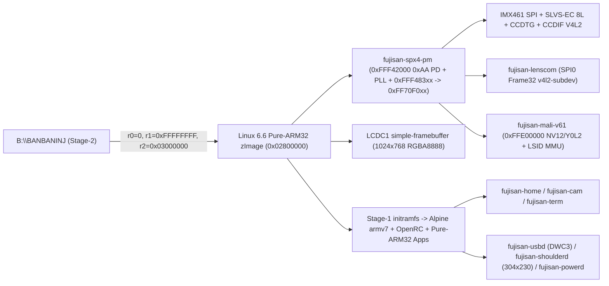

# Fujisan OS — Architecture Specification

**Fujisan OS** is a clean-room, pure-ARM32 Alpine Linux (`armv7`) operating system engineered for **SPX4-MF** medium-format camera hardware (**SPX4** quad-core ARM Cortex-A7 SoC + **IMX461** sensor). It boots non-destructively from SD Card Slot 2 (`B:\BANBANINJ`) with **zero NOR Flash writes to factory calibration or BKUP partitions** and **zero proprietary firmware binaries** in the repository.

## 1. System Overview & 3-Layer Separation

Fujisan OS adheres strictly to the `banban-injector` three-layer contract (see [banban-injector-boot.md](banban-injector-boot.md)):

| Layer | Storage | Role | Mutability |
| --- | --- | --- | --- |
| **Layer 0** | NOR Flash (`0x0001B000`) | Minimal Stage-0 stub; triggers once on live-view entry (`DISP/BACK` bypasses immediately) | Flashed once; factory BKUP/Bank 14 untouched |
| **Layer 1** | SD2 `B:\BANBANINJ` | Hot-swappable Stage-2 bootloader (`boot.cfg` `[entry:fujisan]`, FDT v17 fixups, ARM32 handoff) | Hot-swappable FAT32 file |
| **Layer 2** | SD2 `B:\banban\fujisan\` | Fujisan `zImage`, `fujisan-spx4-mf.dtb`, `initramfs.cpio.gz`, `rootfs.squashfs`, optional `overlay.img` / `fujisan.apkovl.tar.gz` | Hot-swappable FAT32 files |

## 2. Physical DDR Memory Map & Hardware Safety

| Physical Address Range | Size | Purpose |
| --- | ---: | --- |
| `0x0001B000..0x0001FFFF` | `20 KiB` | `banban-injector` Stage-0 resident stub + handoff BSS (outside Linux RAM) |
| `0x02000000..0x045FFFFF` | `38 MiB` | Contiguous Linux physical RAM (`PHYS_OFFSET = 0x02000000`, dual emulator/silicon compatible) |
| `0x02800000` | `<= 5.00 MiB` | `zImage` load and entry physical address |
| `0x03000000` | `<= 256 KiB` | Patched `fujisan-spx4-mf.dtb` (passed in `r2`) |
| `0x03100000` | `<= 5.25 MiB` | `initramfs.cpio.gz` physical load window |
| `0x059ED000..0x06B92FFF` | `3 x 3 MiB` | Live `LCDC1` (`0xFFFA9000`) `1024x768` RGBA8888 OSD0 surfaces (active PA from `0xFFFA9044`) |
| `0x2C4B0000..0x2C545FFF` | `600 KiB` | 4-slot PDAF DDR ping-pong ring (stride `0xD800`) |
| `0xF0000000..0xF2F00000` | `47 MiB` | QSPI NOR Flash XIP aperture — **STRICTLY READ-ONLY** (protects factory BKUP BlockA/B & Bank 14 calibration) |

### Hardware Safety Invariants

1. **Zero Thumb (`0` `$t` symbols)**: Every freestanding binary (`/init`, `fujisan-home`, `fujisan-cam`, `fujisan-term`) is compiled with `-mcpu=cortex-a7 -marm -mno-thumb-interwork -mno-unaligned-access -mgeneral-regs-only -nostdlib -ffreestanding` and audited with `readelf -sW`.
2. **Retail `UART0` Disabled by Default**: `/soc/serial@fff3a000` (`uart0`) is clock-gated on retail SPX4-MF units; the DTB ships `status = "disabled"` so retail hardware never faults on unclocked UART MMIO.
3. **NOR Flash Read-Only Protection**: No driver, init script, or userland utility ever erases or writes QSPI NOR Flash (`0xFFFD8000`). All persistence lives on SD2 (`overlay.img` / `fujisan.apkovl.tar.gz`) and SD1 (`DCIM/100_FJOS/`).

## 3. 4-Layer SPX4 Power & Clock Hierarchy

`fujisan-spx4-pm.c` implements the exact 4-layer cold-boot power-on sequence:

1. **On-Chip Power Islands (`0xFFF42000..0xFFF420FC`, keyed `0xAA`)**: Set `0xFFF42020 |= (1 << d)` for domain `d`, clear `0xFFF42040`, W1C `0xFFF42010 = 0x10`, issue `0xFFF42000 = 0x0000AA01`, and poll `(0xFFF4200C & 0x10) != 0`:
   - `PD 2`: CMOS / SLVS-EC / CCDIF (`0xFFF69000..0xFFF73000`, `0xFFF50000..0xFFF5B000`)
   - `PD 4`: `LCDC0` / `LCDC1` (`0xFFFA9000`, `0xFFF7A000`, `0xFFF49700 = 0x200`)
   - `PD 6, 7, 8`: `IIFP` (`0xFFF80000`)
   - `PD 9`: `UniResz` (`0xFFF7F000`) / `UniJpeg` (`0xFFFA0000`/`0xFFFA1000`) / Still (`0xFFFBB000`)
   - `PD 10`: `Mali-V61` (`0xFFE00000`, GIC IRQ `138`)
   - `PD 13`: `RECC` (`0xFFF82000..0xFFF8A668`, `0xFFFB9000`, `0xFFFBA000`)
2. **PLL & Divider Programming (`0xFF701000..0xFF70C080`)**: Configure PLL multiplier + divider (`[8]=en`, `[7:0]=div`), commit, and poll lock (`+0xF0 & 1 == 0`).
3. **Parent Gate Enable**: Always assert `0xFFF483xx` peripheral reset/clock release **before** `0xFF70F0xx` AXI/bus clock enable.
4. **Staged Sub-Engine Enable (`S0 -> S1 -> S2`)**: Repeat `0xFFF483xx` before `0xFF70F0xx` per sub-engine; power-off runs strictly in reverse (`S2 -> S1 -> S0`, `0xFF70F0xx` before `0xFFF483xx`, then `0xFFF42000 = 0x0000AA02`).

## 4. Rootfs, OpenRC Daemons & Userland Apps

- **Alpine `armv7` Diskless / Overlay Rootfs (`rootfs/`)**: Stage-1 `initramfs.cpio.gz` mounts `B:\banban\fujisan\rootfs.squashfs` read-only and stacks either a persistent ext4 `overlay.img` or RAM `tmpfs` + `fujisan.apkovl.tar.gz` (saved via `fujisan-apkovl-save`). In offline/minimal mode, freestanding `/init` directly launches `fujisan-home`.
- **OpenRC Services (`rootfs/overlay/etc/init.d/`)**:
  - `fujisan-usbd`: Configures Synopsys DWC3 (`0xFFB0C100`) composite USB gadget (NCM Ethernet `172.16.42.1/24`, UVC webcam, MTP).
  - `fujisan-shoulderd`: Drives the `304x230` upright Sharp MIP shoulder LCD (`SPI1` `0xFFF30020`).
  - `fujisan-powerd`: Polls IMX461 sensor temperature (`0x0040/0x0041`) and battery state; performs clean filesystem `sync` on thermal thresholds or shutdown.
- **Pure-ARM32 Apps (`apps/`)**:
  - `fujisan-home`: `1024x768` touch + evdev launcher for Camera, Terminal, USB status, and Stock reboot.
  - `fujisan-cam`: V4L2 live view (`NV12`/`UYVY`), IMX461 exposure/temp, SPI0 `LENSCOM` AF/aperture telemetry, and baseline JFIF capture to SD1 `/mnt/sd1/DCIM/100_FJOS/FJOSxxxx.JPG`.
  - `fujisan-term`: On-screen hardware diagnostics terminal (`help`, `uname`, `hw`, `cmos`, `lens`, `sd`, `clear`, `exit`).
