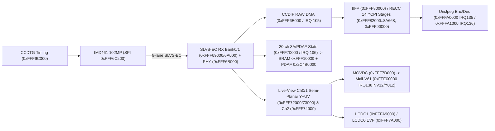

# Fujisan OS — IMX461 CMOS & SPX4 Imaging Pipeline

This document specifies the hardware register interfaces driving the **102 MP Sony IMX461** medium-format sensor, **8-lane SLVS-EC**, **CCDIF / 3A / PDAF**, **IIFP / RECC**, **SPI0 `LENSCOM`**, **BIS Shutter**, and **Mali-V61 4K Video** pipeline on **SPX4-MF** hardware.

## 1. End-to-End Hardware Pipeline



## 2. IMX461 Sensor, SLVS-EC RX/PHY & CCDTG (`fujisan-imx461.c`, `fujisan-slvsec.c`)

| Block | MMIO Base / Range | GIC IRQ | Key Hardware Register Semantics |
| --- | --- | --- | --- |
| **IMX461 SPI Engine** | `0xFFF6C200..0xFFF6C240` | — | `C200 b0` en/reset, `C204 b0` TX start/busy, `C208` mode (`1`=4B write, `3`=4B read). Wire framing: Write `[0x81, hi, lo, val]`, Read `[0x82, hi, lo]`. |
| **IMX461 Register Space** | Over `0xFFF6C200` | — | `0x0000` `STBY`, `0x0001` `MDSEL` (25 sensor modes), `0x0002` `REGHOLD`, `0x0012/13` `PGC`, `0x0018` `DGAIN`, `0x0047..49` `SHR`, `0x019E` sleep gate. **Read Gate**: set `0x004F bit 3 = 0x08` before reading sensor temperature `0x0040/0x0041`. |
| **SLVS-EC RX Bank 0 / 1** | `0xFFF69000..0xFFF69250` / `0xFFF6A000..0xFFF6A250` | `296` (Ch0), `298` (Ch1), `297` (Err) | `9000` Ch0/1 reset/en; `900C b[7:0]` 8-lane active-low enable (`0`=on); `9024/9028` 3x8b PCS error masks; per-ch `+0x08/+0x0C` normal IRQ, `+0x10/+0x14` 10-bit LinkError, `+0x18..+0x24` MacError/FIFO. |
| **SLVS-EC PHY / SerDes** | `0xFFF6B004..0xFFF6B02C`, `0xFFF6B0F0..B0F4` | — | 11 SerDes lane trim & calibration registers (`B010/B014` 8x4b trims). |
| **CCDTG Timing Generator** | `0xFFF6C000..0xFFF6C1D8`, `0xFFF6C280..0xFFF6C42C` | `100`, `102` | `C004 b0` enable, `C008` pixel/bit-depth format (`0..3`), `C00C` 15-bit H/V timing, `C024` lane/depth routing, `C280..C3F8` 6 pulse banks (XVS/XHS). |

## 3. CCDIF RAW DMA, 3A/PDAF Stats & Semi-Planar Live-View (`fujisan-ccdif-v4l2.c`)

- **CCDIF RAW DMA (`0xFFF6E000`, IRQ `105`; `0xFFF6F000`, IRQ `134`)**: Writes 12/14/16-bit Bayer RAW + Optical Black (OB) frames to DDR using 34-bit AXI upper address extension registers (`0xFFF4A700..0xFFF4A790`).
- **20-Channel 3A / AE / AWB / CAF / PDAF / ROB Stats Engine (`0xFFF70000..0xFFF702EC`, IRQ `106`)**:
  - `+0x004`/`+0x008`: 20-channel enable with 10-bit `[25:16]` write masks.
  - `+0x108..+0x120`: Channel/filter config words; `+0x22C..+0x2E0`: 23 x 34-bit DMA destination pairs (including `+0x2D4/+0x2D8` Primary PDAF and `+0x2DC/+0x2E0` Secondary PDAF).
  - **56 KiB On-Chip Stats SRAM (`0xFFF10000..0xFFF1DFFF`)**: Ping-pong double-buffered `2 x 28 KiB` (`0xFFF10000..0xFFF16FFF` / `0xFFF17000..0xFFF1DFFF`) mapped across 37 selectors.
  - **600 KiB PDAF DDR Ring (`0x2C4B0000..0x2C545FFF`)**: 4 ping-pong slots (stride `0xD800` = `55,296 B`: `36 KiB` primary + `18 KiB` secondary PDAF).
- **Live-View DMA Channels (`0xFFF72000` Ch0, `0xFFF73000` Ch1, `0xFFF74000` Ch2)**:
  - Ch0 and Ch1 output **2-plane semi-planar `Y + UV` (`NV12`)** when Plane 1 UV base (`+0xC8/+0xCC`) is programmed (falling back to single-plane packed `UYVY` when Plane 1 is zero).
  - `MOVDC` (`0xFFF7D000`, AXI high `0xFFF4A738/3C`) routes live video streams into `Mali-V61` or HDMI.

## 4. Medium-Format `LENSCOM` SPI0 & BIS Focal-Plane Shutter Delegation

- **Mount `LENSCOM` (`fujisan-lenscom.c`, SPI0)**: Uses `GPIO(0,11)=0`, `GPIO(9,2..4)=1`, `GPIO(15,1)=1` (`LENS_RDY` IRQ `182`), `S12` sync sentinel (`tx=0xA55A3CC3 -> rx=0xC33CA55A`), burst-flush ACK, `cmd 0x014` 131-byte Bulk Read (128-byte Lens Identity Header + `0xFFFF`), `cmd 0x015` Bulk Write (`0x5A` ACK), 40 ms telemetry polling (`0x020..0x03F`), AF drive (`0x040..0x062`), and iris drive (`0x080..0x0A9`). Exposed as a `v4l2-subdev`.
- **Focal-Plane Shutter (`BIS` Sub-MCU over SPI2 `0xFFF34000`)**: SPX4 has no direct GPIO/PWM to mechanical shutter curtains; all mechanical curtain actuation (MS / EFCS) is delegated over SPI2 (`0xFFF34000`) with 32-bit framing (5-bit checksum + 3-bit rolling seq) and Timer channel `29`. Pure electronic shutter (`ES`) runs directly via IMX461 `SHR` timing.

## 5. Mali-V61 4K Video Codec & Clean-Room RASC Firmware Extraction

- **Hardware (`0xFFE00000`, GIC IRQ `138`, `PD 10`)**:
  - 8-bit encode format: `0x0201` (`MVE_BUFFER_FRAME_FORMAT_YUV420_2P` = semi-planar `NV12`).
  - 10-bit 4K Movie format: `0x0121` (`MVE_FORMAT_YUV420_Y0L2` = 1-plane packed 10-bit 2x2-tiled YUV 4:2:0, `stride[0] = stride << 2`).
  - **LSID 2-Level MMU (`0xFFE00200 + lsid * 0x40`)**: `4 KiB` L1 PT + `2.5 MiB` L2 PT pool; maps `.text` RO (`0xC0000002`), per-core private `.bss` + shared `.bss` RW (`0xC0000003`), RPC queues (`0x10000000`), bitstream (`0x20000000+`), internal (`0x42000000+`), and frames (`0x50000000+`).
- **Clean-Room Firmware Extraction (`tools/extract-rasc-fw.py`)**: Because Fujisan OS contains **zero proprietary binaries**, users extract the 4 ARM MVE v2 RASC firmwares from their own stock firmware image (`0x02C60274..0x02D60274`, `^ 0xFF`):
  ```sh
  python3 tools/extract-rasc-fw.py --firmware-dat /path/to/stock-firmware.dat \
      --out-dir /mnt/sd2/banban/fujisan/firmware/mali-v61
  ```
  This writes `mali-v61-hevc-enc.bin` (`0x39000`), `mali-v61-hevc-dec.bin` (`0x2F000`), `mali-v61-h264-enc.bin` (`0x39000`), `mali-v61-h264-dec.bin` (`0x5F000`), and `manifest.json`.
